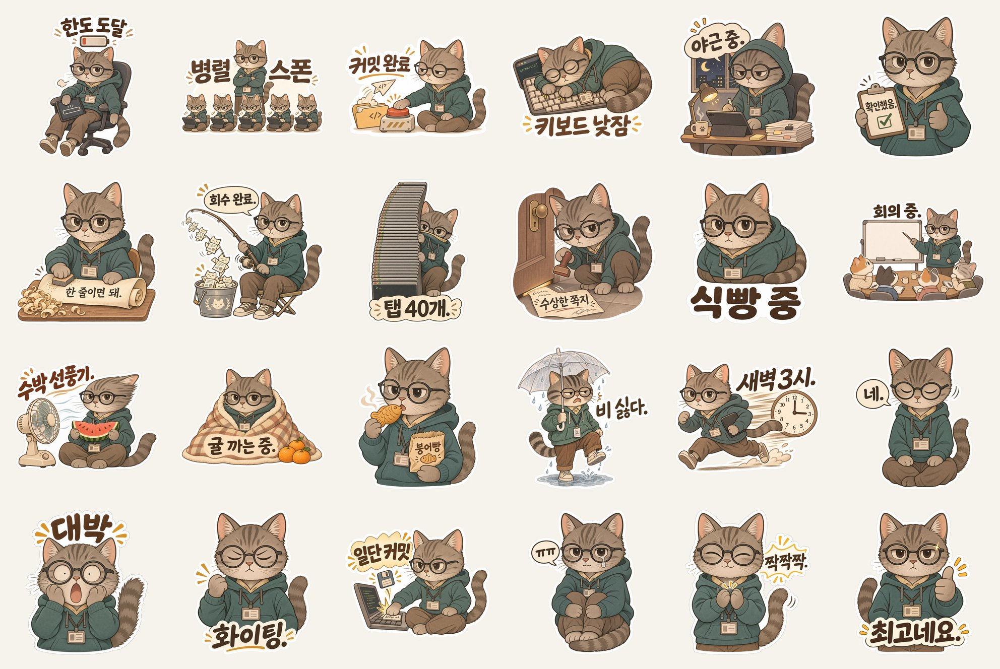
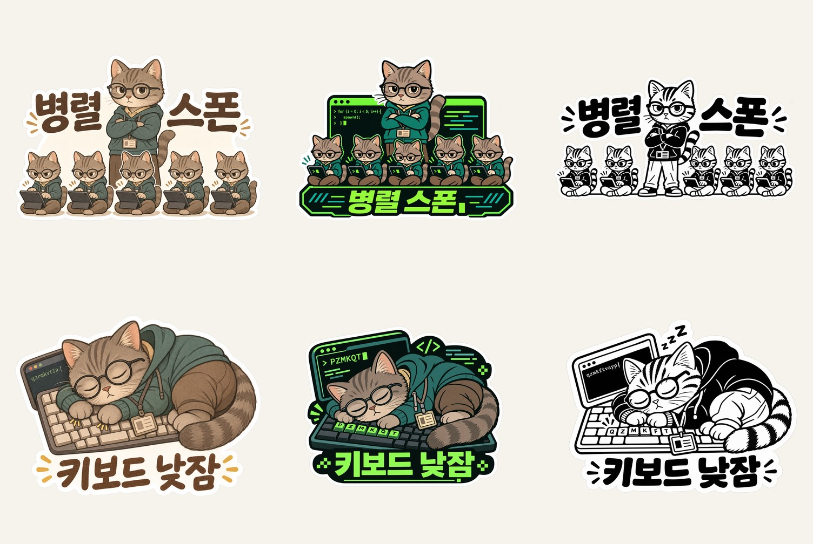

[한국어](README.md) | [English](README.en.md)

# stickerforge



Give it one character image and get hundreds of print-ready transparent PNG stickers. It is a skill that runs in both Codex and Claude Code.

<!-- demo -->

## Install

```
git clone https://github.com/gongnyang/stickerforge && cd stickerforge
./install.sh
```

With no arguments it copies to both Claude Code (`~/.claude/skills`) and Codex (`~/.agents/skills`, `~/.codex/skills`). Use `--claude` or `--codex` to pick one. If the skill is already installed it asks before overwriting (`--yes` skips the question).

You can also install it as a plugin.

```
claude plugin marketplace add gongnyang/stickerforge
claude plugin install stickerforge@gongnyang-tools

codex plugin marketplace add gongnyang/stickerforge
codex plugin add stickerforge@gongnyang-tools
```

## 30-second usage

1. Pick one original character image and the number of stickers you want.
2. Tell Codex or Claude Code, for example: `Use $stickerforge to make 100 stickers of this character` (in Claude Code, `/stickerforge`).
3. You confirm three times. A is the style and count, B is the pilot result, C is the final sheet.

The skill creates a project folder outside the skill folder and fills `spec.json`, `manifest.jsonl`, `out/`, `qc/` and `export/`. If a run stops, it resumes from `manifest.jsonl`.

```
python3 skills/stickerforge/scripts/doctor.py          # check the environment
python3 skills/stickerforge/scripts/run.py <project>    # run, resume
python3 skills/stickerforge/scripts/run.py <project> --status
```

## Stages

| Stage | What happens | Human check |
|---|---|---|
| S0 | Intake, lock the style | A: style and count |
| S1 | Write concepts, compare against the full list, drop duplicates | none |
| S2 | Pilot generation | B: pilot result |
| S3 | Batch generation. Default 8 at once, cap 10 | none |
| S4 | Automatic gates | none |
| S5 | Regenerate failures, up to 2 times per sticker | report count at the limit |
| S6 | Contact sheet and delivery folder | C: final |

No batch run starts before B is approved. Only the original character image is used as a reference; generated images never are. No text is added on top of an image afterwards. If a glyph is wrong, the sticker is regenerated.

## Supported environments

| Environment | Status |
|---|---|
| Codex only | Works |
| Claude Code with Codex | Works |
| OpenAI API key | Should work with an API key |
| Gemini API key | Should work with an API key |
| Claude Code only, no key | Unsupported. `doctor.py` prints the reason |

## Automatic checks

Scripts in `scripts/gates/` check every PNG in a folder at S4. Each gate reports by exit code, and only failed stickers are regenerated in S5.

| Gate | Checks |
|---|---|
| size | Minimum size |
| alpha | Alpha channel and transparent area ratio. Alpha of 12 and below is set to 0, 240 and above to 255 |
| checker | Fake transparency, a checkerboard painted into the pixels |
| margin | Margin to the canvas edge, suspected cropping |
| outline | Outline state |
| dup | Duplicates within the set |

A visual review by a person is a sample, not a full check. The gates are the full check.

## Style presets

Six presets live in `skills/stickerforge/styles/`. The default is original-match.

| Preset | Description |
|---|---|
| original-match | Keeps the exact drawing style of the reference, draws new poses only |
| chibi-soft | Large head, small body, soft pastel |
| flat-vector | Flat fills with six colors or fewer, no gradients |
| mono-ink | One ink color, for one-color print |
| toy-3d | Soft 3D like a vinyl toy |
| retro-mission-patch | Embroidered patch badge |



The comparison shows two concepts (top and bottom rows), drawn from left to right in the original style, a terminal style and mono ink.

## Printing

The built-in Codex image tool has no size argument, so output is around 1254 to 1536 px. At 300 dpi that is about 10 to 13 cm on the short side (10.6 cm for 1254 px, 13 cm for 1536 px). The art fills 70 to 90 percent of the canvas, so the printed sticker is smaller. A 50 mm sticker needs about 590 px of content, which is enough. Stickers over 100 mm may fall under 300 dpi. The skill reports the real dpi and does not upscale to hide it. For larger output, use an API provider with a size argument.

White border of 2 to 3 mm and a die-cut line 1 to 2 mm outside it are covered in `skills/stickerforge/references/print-guide.md`.

## Cost and limits

The skill itself is free. Cost goes to the account of the provider you use. The Codex path uses the image generation limit of your ChatGPT account. The limit is per account, so raising concurrency does not raise throughput. Measured: the first pilot sticker took about 80 to 170 seconds, and two at once took about 90 seconds. On a quota or 429 error the run stops, saves the remaining list and prints the resume command. Before a batch, S0 shows the expected time and quota use and asks for approval.

Each generation thread leaves a session rollout of about 10 MB per sticker under `~/.codex/sessions`. `run.py <project> --cleanup` deletes only this project's threads.

## Copyright and likeness

- Use only characters you own or have permission to use.
- Third-party logos and trademarks are not generated.
- Real people appear only with their own consent. Do not use it to mock public figures.
- Ownership of generated images and commercial use follow the terms of the image service you use. Check before selling.

## License

MIT. See [LICENSE](LICENSE).
