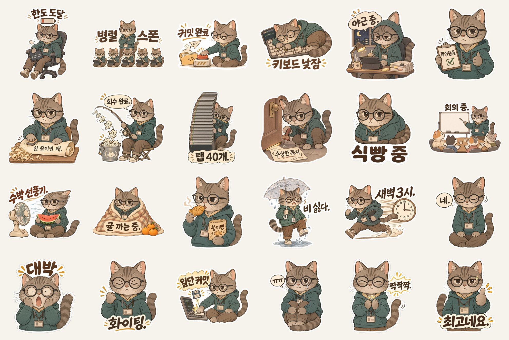
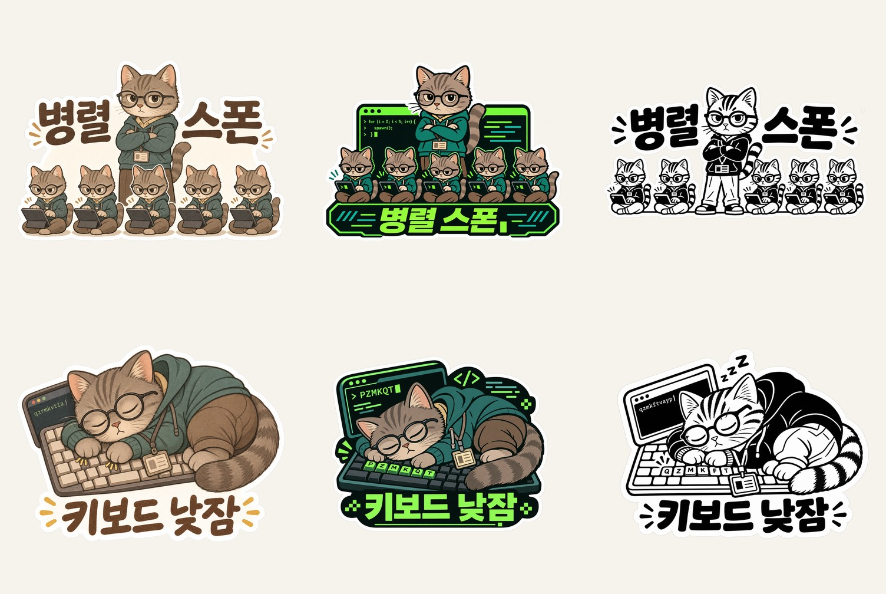

[한국어](README.md) | [English](README.en.md)

# stickerforge



캐릭터 이미지 한 장을 넣으면 인쇄용 투명 PNG 스티커 수백 장이 나옵니다. Codex와 Claude Code 양쪽에서 쓰는 스킬입니다.

<!-- demo -->

## 설치

```
git clone https://github.com/gongnyang/stickerforge && cd stickerforge
./install.sh
```

인자 없이 실행하면 Claude Code(`~/.claude/skills`)와 Codex(`~/.agents/skills`, `~/.codex/skills`) 양쪽에 복사합니다. `--claude`, `--codex`로 한쪽만 고르고, 이미 있으면 덮어쓰기 전에 묻습니다(`--yes`로 생략).

플러그인으로 설치할 수도 있습니다.

```
claude plugin marketplace add gongnyang/stickerforge
claude plugin install stickerforge@gongnyang-tools

codex plugin marketplace add gongnyang/stickerforge
codex plugin add stickerforge@gongnyang-tools
```

## 30초 사용법

1. 캐릭터 원본 이미지 한 장과 원하는 장수를 정합니다.
2. Codex 또는 Claude Code에서 말합니다. 예: `$stickerforge 로 이 캐릭터 스티커 100장 만들어줘` (Claude Code에서는 `/stickerforge`).
3. 사람이 세 번 확인합니다. A는 그림체와 장수, B는 시험 생성 결과, C는 최종 시트입니다.

스킬이 작업 폴더(스킬 폴더 밖)를 만들고 `spec.json`, `manifest.jsonl`, `out/`, `qc/`, `export/`를 채웁니다. 중간에 멈춰도 `manifest.jsonl`에서 이어서 실행합니다.

```
python3 skills/stickerforge/scripts/doctor.py          # 환경 확인
python3 skills/stickerforge/scripts/run.py <작업폴더>    # 실행, 재개
python3 skills/stickerforge/scripts/run.py <작업폴더> --status
```

## 동작 단계

| 단계 | 하는 일 | 사람 확인 |
|---|---|---|
| S0 | 의뢰 받기, 그림체 고정 | A: 그림체와 장수 |
| S1 | 컨셉 목록 작성, 전체 목록과 대조해 중복 제거 | 없음 |
| S2 | 시험 생성 | B: 시험 결과 |
| S3 | 양산. 동시 8개 기본, 상한 10 | 없음 |
| S4 | 자동 검수 | 없음 |
| S5 | 불합격분 재생성, 장당 2회까지 | 한도에 닿으면 장수 보고 |
| S6 | 컨택트 시트와 납품 폴더 | C: 최종 |

B 승인 전에는 양산하지 않습니다. 원본 캐릭터 이미지만 참조로 쓰고, 생성물은 참조로 쓰지 않습니다. 그림 위에 글자를 얹지 않으며, 글자가 틀리면 재생성합니다.

## 지원 환경

| 환경 | 상태 |
|---|---|
| Codex 단독 | 됩니다 |
| Claude Code + Codex | 됩니다 |
| OpenAI API 키 | 키가 있으면 쓸 수 있을 거예요 |
| Gemini API 키 | 키가 있으면 쓸 수 있을 거예요 |
| Claude Code만, 키 없음 | 지원하지 않습니다. `doctor.py`가 사유를 알려 줍니다 |

## 자동 검수 항목

`scripts/gates/`의 스크립트가 S4에서 폴더 단위로 PNG를 검사합니다. 종료 코드로 판정하며, 불합격한 장만 S5에서 다시 만듭니다.

| 게이트 | 검사 |
|---|---|
| size | 최소 크기 |
| alpha | 알파 채널과 투명 영역 비율. 알파 12 이하는 0, 240 이상은 255로 정리 |
| checker | 체크무늬가 픽셀에 박힌 가짜 투명 |
| margin | 캔버스 가장자리 여백, 잘림 의심 |
| outline | 외곽선 상태 |
| dup | 세트 안의 중복 |

사람이 하는 시각 검수는 표본 확인이며 전수 검사가 아닙니다. 전수 검사는 게이트입니다.

## 그림체 프리셋

`skills/stickerforge/styles/`에 여섯 개가 있습니다. 기본값은 original-match입니다.

| 프리셋 | 내용 |
|---|---|
| original-match | 원본 그림체를 그대로 유지하고 포즈만 새로 그림 |
| chibi-soft | 큰 머리, 작은 몸, 부드러운 파스텔 |
| flat-vector | 여섯 색 이하의 단색 면, 그라데이션 없음 |
| mono-ink | 잉크 한 색, 단색 인쇄용 |
| toy-3d | 비닐 장난감 같은 부드러운 3D |
| retro-mission-patch | 자수 패치 느낌의 배지 |



위 비교는 컨셉 두 개(위, 아래 줄)를 왼쪽부터 원본 그림체, 터미널 풍, 흑백 잉크로 그린 것입니다.

## 인쇄 안내

Codex 내장 이미지 도구에는 크기 인자가 없어 결과가 1254~1536px 근처입니다. 300dpi로 인쇄하면 한 변 기준 약 10~13cm입니다(1254px는 10.6cm, 1536px는 13cm). 그림이 캔버스의 70~90%를 차지하므로 실제 인쇄 크기는 이보다 작습니다. 50mm 스티커는 내용 약 590px이면 되어 충분합니다. 100mm를 넘는 큰 스티커는 300dpi에 못 미칠 수 있습니다. 이때 업스케일로 숨기지 않고 실제 dpi를 알려 줍니다. 더 큰 출력이 필요하면 크기 인자가 있는 API provider를 씁니다.

흰 테두리 2~3mm, 칼선은 외곽선에서 1~2mm 바깥으로 두는 기준은 `skills/stickerforge/references/print-guide.md`에 있습니다.

## 비용과 한도

이 스킬은 별도 요금을 받지 않습니다. 비용은 쓰는 provider의 계정에서 나갑니다. Codex 경로는 ChatGPT 계정의 이미지 생성 한도를 씁니다. 한도는 계정 단위라서 동시성을 올려도 처리량이 늘지 않습니다. 실측으로 첫 장 시험 생성은 약 80~170초, 이후 2장 동시 생성은 약 90초였습니다. 한도나 429 오류가 나면 실행을 멈추고 남은 목록을 저장하며, 재개 명령을 안내합니다. 양산 전에 S0에서 예상 시간과 한도 사용량을 보여 주고 승인을 받습니다.

생성하는 동안 장당 약 10MB의 세션 기록이 `~/.codex/sessions`에 쌓입니다. `run.py <작업폴더> --cleanup`은 이 프로젝트 스레드의 기록만 지웁니다.

## 저작권과 초상권

- 본인이 권리를 가진 캐릭터 또는 허락받은 캐릭터만 넣으세요.
- 타사 로고와 상표는 만들지 않습니다.
- 실존 인물은 본인 동의가 있을 때만 다룹니다. 공인을 조롱하는 용도는 쓰지 않습니다.
- 생성물의 저작권 귀속과 상업 이용 가능 여부는 쓰는 이미지 서비스의 약관을 따릅니다. 판매 전에 확인하세요.

## 라이선스

MIT. [LICENSE](LICENSE) 참고.
